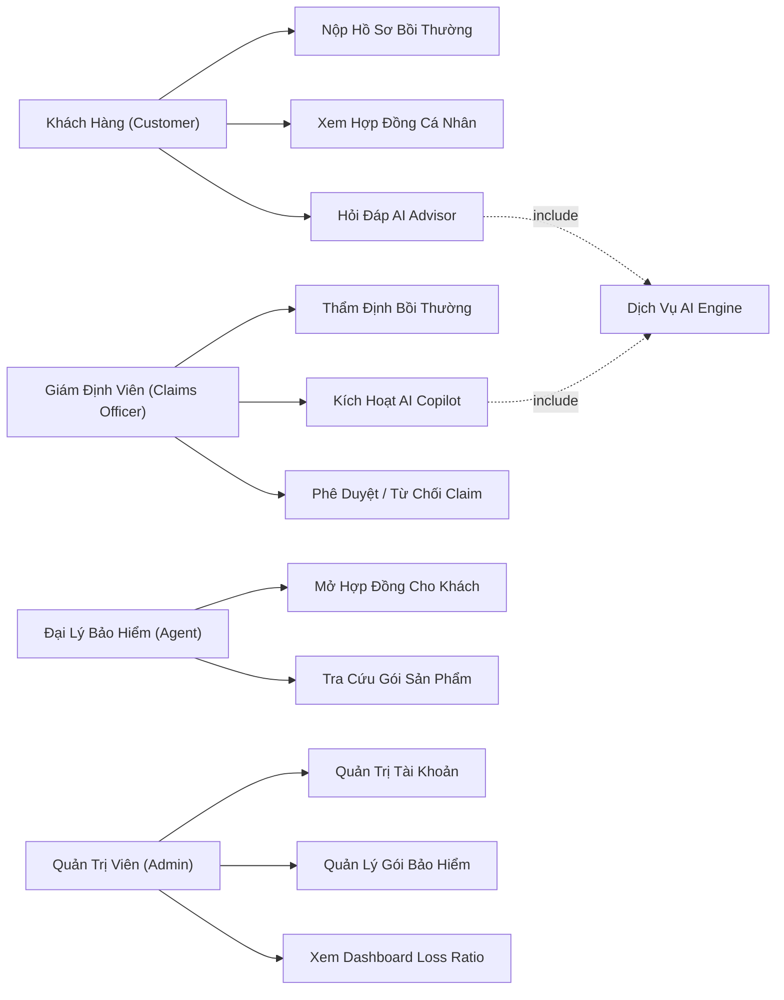
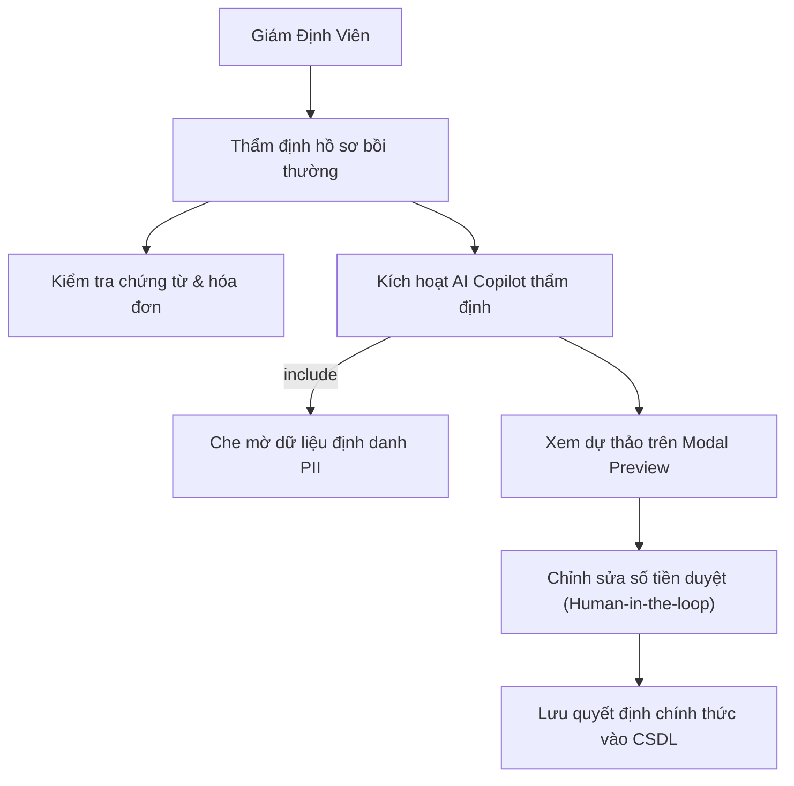
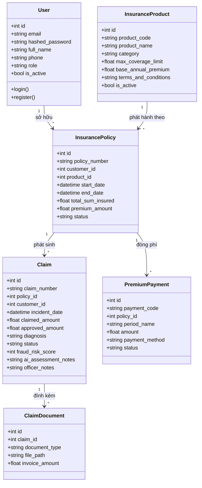
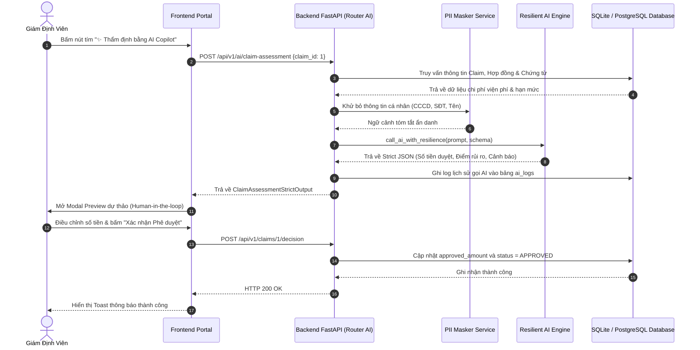
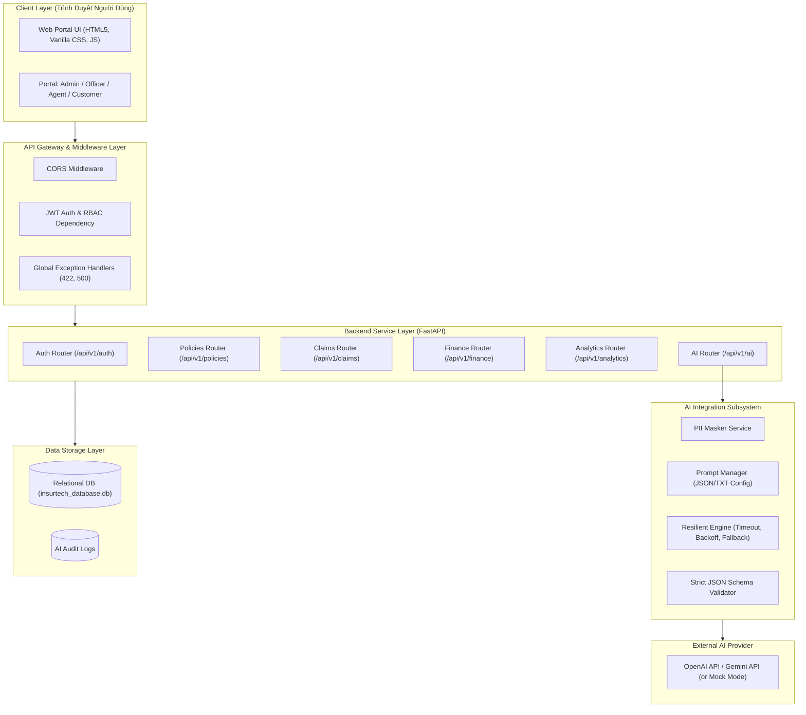
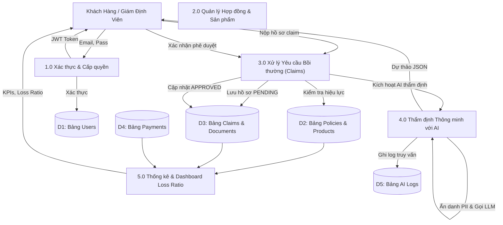
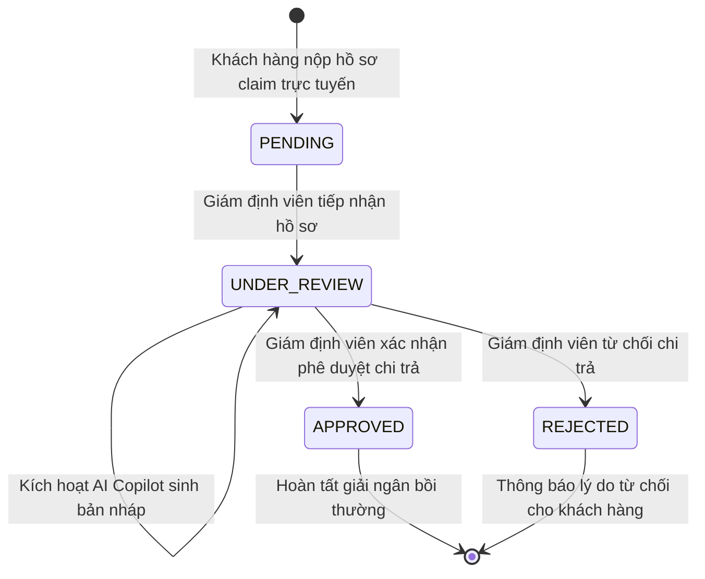
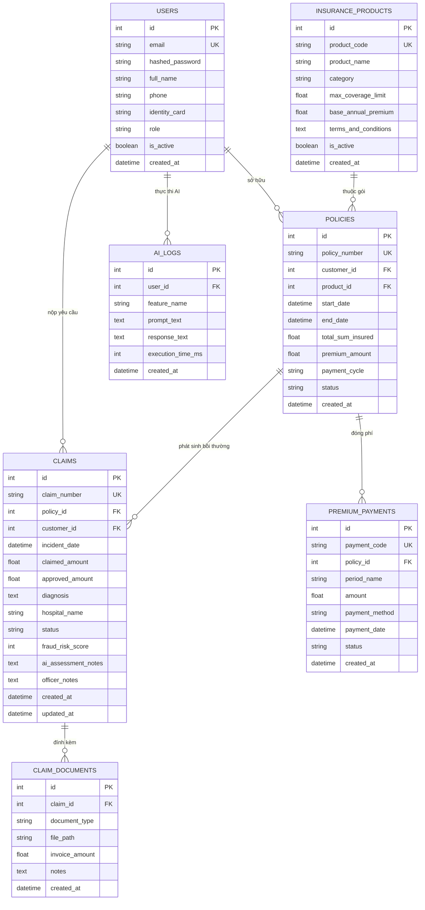

# BÁO CÁO HỌC PHẦN: ỨNG DỤNG TRÍ TUỆ NHÂN TẠO

**TRƯỜNG ĐẠI HỌC CÔNG NGHỆ THÔNG TIN VÀ TRUYỀN THÔNG**  
**KHOA CÔNG NGHỆ THÔNG TIN**  

---

### ĐỀ TÀI: XÂY DỰNG HỆ THỐNG QUẢN LÝ BẢO HIỂM CÓ TÍCH HỢP AI (INSURTECH SMART SYSTEM)

- **Giảng viên hướng dẫn:** ThS. Nguyễn Đình Dũng  
- **Sinh viên thực hiện:**
  1. **Nguyễn Minh Quang** - Lớp: KTPM K23C
  2. **Lê Đắc Lộc** - Lớp: KTPM K23C

---

## MỤC LỤC

- [CHƯƠNG I: LẬP KẾ HOẠCH DỰ ÁN](#chương-i-lập-kế-hoạch-dự-án)
  - [1.1. Lý do chọn đề tài](#11-lý-do-chọn-đề-tài)
  - [1.2. Kế hoạch triển khai dự án và phân công nhiệm vụ](#12-kế-hoạch-triển-khai-dự-án-và-phân-công-nhiệm-vụ)
- [CHƯƠNG II: ĐẶC TẢ YÊU CẦU](#chương-ii-đặc-tả-yêu-cầu)
  - [2.1. Khảo sát nghiệp vụ](#21-khảo-sát-nghiệp-vụ)
  - [2.2. Thu thập, làm rõ yêu cầu của hệ thống (Requirements Q&A)](#22-thu-thập-làm-rõ-yêu-cầu-của-hệ-thống-requirements-qa)
  - [2.3. Yêu cầu chức năng (Functional Requirements)](#23-yêu-cầu-chức-năng)
  - [2.4. Yêu cầu phi chức năng (Non-Functional Requirements)](#24-yêu-cầu-phi-chức-năng)
  - [2.5. Sơ đồ phân cấp chức năng (Functional Decomposition Diagram)](#25-sơ-đồ-phân-cấp-chức-năng)
- [CHƯƠNG III: PHÂN TÍCH VÀ THIẾT KẾ HỆ THỐNG](#chương-iii-phân-tích-và-thiết-kế-hệ-thống)
  - [3.1. Biểu đồ Use Case](#31-biểu-đồ-use-case)
  - [3.2. Đặc tả Use Case chi tiết](#32-đặc-tả-use-case)
  - [3.3. Thiết kế Prompt và luồng gọi AI](#33-thiết-kế-prompt-và-luồng-gọi-ai)
  - [3.4. Minh chứng dùng AI trong phân tích và thiết kế](#34-minh-chứng-dùng-ai-trong-phân-tích-và-thiết-kế)
  - [3.5. Biểu đồ lớp (Class Diagram)](#35-biểu-đồ-lớp-class-diagram)
  - [3.6. Biểu đồ tuần tự (Sequence Diagram)](#36-biểu-đồ-tuần-tự-sequence-diagram)
  - [3.7. Sơ đồ kiến trúc hệ thống (System Architecture Diagram)](#37-sơ-đồ-kiến-trúc-hệ-thống)
  - [3.8. Sơ đồ luồng dữ liệu (Data Flow Diagram - DFD)](#38-sơ-đồ-luồng-dữ-liệu-dfd)
  - [3.9. Sơ đồ trạng thái vòng đời hồ sơ bồi thường (State Diagram)](#39-sơ-đồ-trạng-thái-vòng-đời-hồ-sơ-bồi-thường)
  - [3.10. Xác định vị trí chiến lược ứng dụng AI](#310-xác-định-vị-trí-ứng-dụng-ai)
- [CHƯƠNG IV: THIẾT KẾ CƠ SỞ DỮ LIỆU VÀ CÀI ĐẶT DEMO](#chương-iv-thiết-kế-cơ-sở-dữ-liệu-và-cài-đặt-demo)
  - [4.1. Sơ đồ thực thể liên kết (ERD)](#41-sơ-đồ-thực-thể-liên-kết-erd)
  - [4.2. Kết nối CSDL và script khởi tạo dữ liệu mẫu (Seed Data)](#42-kết-nối-csdl-và-script-khởi-tạo-dữ-liệu-mẫu-seed-data)
  - [4.3. Thiết kế giao diện (UI/UX)](#43-thiết-kế-giao-diện)
  - [4.4. Cơ chế xử lý lỗi và sơ đồ luồng Exception Handling](#44-cơ-chế-xử-lý-lỗi-và-sơ-đồ-luồng-exception-handling)
  - [4.5. Cấu trúc cây thư mục dự án](#45-cấu-trúc-cây-thư-mục-dự-án)
  - [4.6. Xây dựng chức năng đăng nhập – phân quyền (RBAC)](#46-xây-dựng-chức-năng-đăng-nhập--phân-quyền-rbac)
  - [4.7. Hoàn thiện CRUD nghiệp vụ cốt lõi](#47-hoàn-thiện-crud-nghiệp-vụ-cốt-lõi)
- [CHƯƠNG V: KIỂM THỬ CHỨC NĂNG VÀ HOÀN THIỆN](#chương-v-kiểm-thử-chức-năng-và-hoàn-thiện)
  - [5.1. Tích hợp AI vào Nghiệp vụ Hệ thống & Bảo vệ API Key](#51-tích-hợp-ai-vào-nghiệp-vụ-hệ-thống--kết-nối-api-đúng-cách-bảo-vệ-api-key)
  - [5.2. Minh chứng sử dụng AI (Prompt Log & Human-in-the-loop)](#52-minh-chứng-sử-dụng-ai-prompt-log--human-in-the-loop)
  - [5.3. Thiết kế Prompt có Hệ thống (Strict JSON Schema)](#53-thiết-kế-prompt-có-hệ-thống-tách-code-strict-json-schema)
  - [5.4. Tối ưu hóa Prompt qua 3 vòng thử nghiệm (V1, V2, V3)](#54-tối-ưu-hóa-prompt-qua-3-vòng-thử-nghiệm-v1-v2-v3)
  - [5.5. Khai thác dữ liệu hệ thống & Bảo mật thông tin nhạy cảm (PII Masking)](#55-khai-thác-dữ-liệu-hệ-thống--bảo-mật-thông-tin-nhạy-cảm-rbac--pii-masking)
  - [5.6. Hiển thị kết quả rõ ràng & Dòng cảnh báo Disclaimer](#56-hiển-thị-kết-quả-rõ-ràng--dòng-cảnh-báo-disclaimer)
  - [5.7. Xử lý lỗi & Giới hạn của AI (Resilience, Retry, Backoff, Fallback)](#57-xử-lý-lỗi--giới-hạn-của-ai-resilience-retry-backoff-fallback)
  - [5.8. Bộ Test Cases kiểm thử tự động & thủ công](#58-bộ-test-cases-kiểm-thử-tự-động--thủ-công)
  - [5.9. Review Code & Cải thiện chất lượng bằng AI (Security & Architecture Audit)](#59-review-code--cải-thiện-chất-lượng-bằng-ai-security--architecture-audit)
  - [5.10. Tối ưu trải nghiệm người dùng UX/UI (AI Copilot Workflow vs Main CRUD)](#510-tối-ưu-trải-nghiệm-người-dùng-uxui-ai-copilot-workflow-vs-main-crud)
  - [5.11. Bảng tổng hợp mức độ hoàn thành 10 tiêu chí đánh giá](#511-bảng-tổng-hợp-mức-độ-hoàn-thành-10-tiêu-chí-đánh-giá)
  - [5.12. Quản lý mã nguồn Git, Test Case và hướng dẫn chạy ứng dụng](#512-quản-lý-mã-nguồn-git-test-case-và-hướng-dẫn-chạy-ứng-dụng)

---

# CHƯƠNG I: LẬP KẾ HOẠCH DỰ ÁN

## 1.1. Lý do chọn đề tài
- **Nhu cầu thực tế:** Ngành bảo hiểm (bảo hiểm y tế, sức khỏe, tai nạn, tài sản) đóng vai trò lá chắn tài chính quan trọng trong nền kinh tế. Tuy nhiên, quy trình vận hành bảo hiểm truyền thống tại Việt Nam hiện đang đối mặt với nhiều rào cản lớn: tiếp nhận hồ sơ giấy thủ công tốn thời gian, giải quyết bồi thường (claims) kéo dài từ 15 đến 30 ngày, chứng từ y tế cồng kềnh, quy tắc thẩm định phức tạp và khó khăn trong phát hiện gian lận bảo hiểm (fraud detection).
- **Cơ hội phát triển:** Làn sóng công nghệ bảo hiểm (InsurTech) kết hợp Trí tuệ nhân tạo (AI/LLM) đang bùng nổ. Ứng dụng AI cho phép tự động hóa quy trình phân tích bệnh án/hóa đơn, chấm điểm rủi ro hồ sơ (Risk Scoring), phát hiện bất thường gian lận bồi thường và cung cấp trợ lý ảo giải đáp quy tắc điều khoản 24/7.
- **Sự tiện lợi và hiệu quả:** Rút ngắn thời gian xử lý yêu cầu bồi thường từ hàng tuần xuống còn dưới 5 giây đối soát tự động, hỗ trợ Giám định viên ra quyết định chuẩn xác và minh bạch quyền lợi cho khách hàng.
- **Sự cần thiết:** Khắc phục triệt để tình trạng thất thoát tài chính do trục lợi bảo hiểm, giảm thiểu sai sót tính toán hạn mức, tuân thủ nghiêm ngặt bảo mật dữ liệu y tế cá nhân (PII Masking).

## 1.2. Kế hoạch triển khai dự án và phân công nhiệm vụ

| Tuần | Công việc cụ thể | Phân công | Sản phẩm bàn giao |
| :--- | :--- | :--- | :--- |
| **Tuần 01** (27/07 - 02/08) | Khảo sát bài toán InsurTech, xác định điểm nghẽn có thể giải bằng AI, phân chia vai trò stakeholder, chuẩn hóa thư mục. | Nguyễn Minh Quang, Lê Đắc Lộc | DEL-001: Project Scope<br>DEL-002: Project Plan & Prompt Standards |
| **Tuần 02** (03/08 - 09/08) | Làm rõ yêu cầu nghiệp vụ và yêu cầu AI: Thẩm định hồ sơ bồi thường, Chatbot tư vấn điều khoản. Lập bảng Requirements Q&A. | Nguyễn Minh Quang, Lê Đắc Lộc | DEL-003: Bảng Requirements Q&A chi tiết (QA-001 đến QA-020) |
| **Tuần 03** (10/08 - 16/08) | Viết đặc tả yêu cầu chức năng (REQ-F), phi chức năng (NFR), yêu cầu AI (REQ-AI), Business Rules và ma trận truy vết. | Nguyễn Minh Quang, Lê Đắc Lộc | DEL-004: Tài liệu SRS hoàn chỉnh |
| **Tuần 04** (17/08 - 23/08) | Thiết kế kiến trúc tổng thể, biểu đồ lớp (Class Diagram), biểu đồ tuần tự (Sequence Diagram), thiết kế Prompt Manager & Resilience Engine. | Nguyễn Minh Quang, Lê Đắc Lộc | DEL-005: Tài liệu OOD; Mốc đánh giá KT1 |
| **Tuần 05** (24/08 - 30/08) | Thiết kế CSDL quan hệ (ERD), bảng người dùng, gói bảo hiểm, hợp đồng, claims, payments, log AI. Thiết lập ràng buộc toàn vẹn. | Nguyễn Minh Quang, Lê Đắc Lộc | DEL-006: Database Design (ERD) & UI Wireframes |
| **Tuần 06** (31/08 - 06/09) | Cài đặt Backend FastAPI, ORM SQLAlchemy, cấu hình JWT Token và phân quyền RBAC. Hoàn thiện CRUD cốt lõi và nạp seed data. | Nguyễn Minh Quang, Lê Đắc Lộc | DEL-007: Backend Core CRUD thông suốt (Mốc KT2) |
| **Tuần 07** (07/09 - 13/09) | Tích hợp AI Claim Assessment & Fraud Detection, AI Advisor Chatbot. Xây dựng PII Masker, Resilient Engine (Timeout, Backoff, Fallback). | Nguyễn Minh Quang, Lê Đắc Lộc | DEL-008: Module AI tích hợp hoàn chỉnh |
| **Tuần 08** (14/09 - 20/09) | Viết bộ kiểm thử Pytest tự động, ma trận kiểm thử thủ công (Happy, Negative, RBAC, Edge). Tối ưu giao diện Human-in-the-loop. | Nguyễn Minh Quang, Lê Đắc Lộc | DEL-009: Test Suite & Bug Log (Mốc KT3) |
| **Tuần 09** (21/09 - 27/09) | Viết README.md, file .env.example, kịch bản 1-click run_all.bat, Code Security Audit và chuẩn bị báo cáo bảo vệ cuối kỳ. | Nguyễn Minh Quang, Lê Đắc Lộc | DEL-010, DEL-011, DEL-012: Báo cáo hoàn chỉnh |

---

# CHƯƠNG II: ĐẶC TẢ YÊU CẦU

## 2.1. Khảo sát nghiệp vụ
Thực trạng quản lý bảo hiểm truyền thống gặp phải 4 điểm nghẽn lớn:
1. **Thời gian giải quyết claim kéo dài:** Từ 7 - 30 ngày do nhân viên phải đối soát thủ công từng dòng viện phí với hợp đồng giấy.
2. **Nguy cơ trục lợi bảo hiểm tinh vi:** Chiếm 10% - 15% tổng chi trả bảo hiểm mỗi năm với các hành vi như nâng khống hóa đơn, khai man bệnh án.
3. **Khách hàng khó hiểu quyền lợi:** Hợp đồng dài từ 30 - 60 trang chứa nhiều thuật ngữ khó hiểu, dẫn đến thắc mắc và khiếu nại kéo dài.
4. **Dữ liệu phân tán:** Thiếu báo cáo tỷ lệ bồi thường (Loss Ratio) thời gian thực để cảnh báo nguy cơ bội chi tài chính.

## 2.2. Thu thập, làm rõ yêu cầu của hệ thống (Requirements Q&A)

```
[Bảng tổng hợp 20 câu hỏi yêu cầu nghiệp vụ InsurTech]
QA-001 -> Phạm vi: Bao phủ 5 phân hệ (Hợp đồng, Sản phẩm, Bồi thường, Thu phí, Dashboard).
QA-002 -> Quy trình Claim: Khách hàng nộp -> Chờ xử lý -> AI thẩm định -> Giám định viên duyệt.
QA-003 -> Actor: Admin, Claims Officer, Agent, Customer, AI Service.
QA-004 -> Phân quyền hồ sơ: Khách hàng chỉ xem của mình; Giám định viên có quyền duyệt.
QA-005 -> Dữ liệu Hợp đồng: policy_number, customer_id, product_id, sum_insured, premium.
QA-006 -> Dữ liệu Claim: claim_number, incident_date, claimed_amount, diagnosis, hospital.
QA-007 -> Thu phí định kỳ: Theo dõi lịch sử kỳ phí, phương thức thanh toán, hạn nộp.
QA-008 -> Dashboard KPI: Active Policies, Tổng doanh thu, Tổng bồi thường, Loss Ratio (%).
QA-009 -> Tìm kiếm & Lọc: Tìm theo mã hồ sơ, tên khách hàng, lọc theo trạng thái PENDING/APPROVED.
QA-010 -> Guardrail Chatbot: Tuyệt đối chỉ trả lời dựa trên điều khoản có sẵn trong CSDL.
QA-011 -> AI Thẩm định Claim: Nhận chẩn đoán + viện phí -> Trả Strict JSON: số tiền duyệt, cảnh báo.
QA-012 -> AI Risk Scoring: Đánh giá rủi ro khách hàng ẩn danh (nhóm tuổi, tỷ lệ claim).
QA-013 -> Chịu lỗi AI: Timeout 15s, Exponential Backoff lỗi 429, Fallback Mode an toàn.
QA-014 -> An toàn PII: Che số CCCD, SĐT, số tài khoản trước khi gửi sang API AI bên ngoài.
QA-015 -> Ràng buộc nộp Claim: Hợp đồng phải ở trạng thái ACTIVE và trong thời hạn hiệu lực.
QA-016 -> Khống chế trần bồi thường: Số tiền duyệt không được vượt hạn mức tối đa của hợp đồng.
QA-017 -> Tech Stack: Python 3.11/3.12, FastAPI, SQLAlchemy, Vanilla CSS/JS Responsive, OpenAI/Mock.
QA-018 -> NFR Hiệu năng: API CRUD < 1s; Gọi AI < 5s; Chịu tải tối thiểu 200 concurrent requests.
QA-019 -> Vận hành: Script 1-Click run_all.bat trên Windows, cấu hình biến môi trường qua .env.
QA-020 -> Giới hạn phiên bản: Mock thanh toán và Mock hồ sơ bệnh án để tập trung core AI.
```

## 2.3. Yêu cầu chức năng
- **F-01: Quản trị tài khoản & Phân quyền RBAC:** Đăng nhập, băm mật khẩu Bcrypt, cấp JWT Token cho 4 vai trò.
- **F-02: Quản lý danh mục gói bảo hiểm:** Cấu hình hạn mức tối đa, phí cơ bản, quy tắc quyền lợi và loại trừ.
- **F-03: Phát hành hợp đồng bảo hiểm:** Cấp số hợp đồng tự động, thiết lập chu kỳ nộp phí, kích hoạt bảo vệ.
- **F-04: Tiếp nhận hồ sơ bồi thường (Claim):** Khách hàng nộp claim trực tuyến kèm chứng từ hóa đơn y tế.
- **F-05: Quản lý thu phí định kỳ:** Ghi nhận thanh toán phí, gia hạn hiệu lực hợp đồng.
- **F-06: Thống kê & Dashboard Loss Ratio:** Biểu đồ doanh thu vs bồi thường, tính toán Loss Ratio thời gian thực.
- **F-AI-07: AI Claim Assessment & Fraud Detection:** Phân tích viện phí, đối soát hạn mức, phát hiện gian lận.
- **F-AI-08: AI Advisor Chatbot:** Trợ lý ảo tư vấn gói bảo hiểm và giải đáp điều khoản 24/7.
- **F-AI-09: AI Underwriting Risk Scorer:** Chấm điểm rủi ro khách hàng ẩn danh phục vụ định phí.

## 2.4. Yêu cầu phi chức năng
1. **Bảo mật:** Không lưu mật khẩu plaintext (Bcrypt), JWT 24h, bảo vệ API Key qua `.env`, lọc sạch PII y tế.
2. **Hiệu năng:** CRUD API < 1s, AI response < 5s, tải đồng thời 200 người dùng.
3. **Độ tin cậy:** Khả dụng 99%, có Resilient Engine tự động chuyển Fallback Mode khi AI timeout > 15s.
4. **UX/UI:** Visual contrast rõ ràng giữa nút CRUD (xanh lá/xanh dương) và nút AI Copilot (màu tím `#6f42c1`).

## 2.5. Sơ đồ phân cấp chức năng

```mermaid
graph TD
    Root["HỆ THỐNG QUẢN LÝ BẢO HIỂM TÍCH HỢP AI (INSURTECH)"]
    
    Root --> F1["1. Quản Trị & Xác Thực"]
    F1 --> F11["1.1 Đăng ký / Đăng nhập"]
    F1 --> F12["1.2 Quản lý phiên JWT"]
    F1 --> F13["1.3 Phân quyền 4 vai trò (RBAC)"]
    
    Root --> F2["2. Sản Phẩm & Hợp Đồng"]
    F2 --> F21["2.1 Quản lý danh mục gói bảo hiểm"]
    F2 --> F22["2.2 Phát hành hợp đồng mới"]
    F2 --> F23["2.3 Tra cứu trạng thái hợp đồng"]
    
    Root --> F3["3. Quản Lý Bồi Thường (Claims)"]
    F3 --> F31["3.1 Khách hàng nộp Claim online"]
    F3 --> F32["3.2 Đính kèm chứng từ viện phí"]
    F3 --> F33["3.3 Giám định viên xét duyệt / từ chối"]
    
    Root --> F4["4. Thu Phí & Tài Chính"]
    F4 --> F41["4.1 Quản lý kỳ phí đến hạn"]
    F4 --> F42["4.2 Ghi nhận thanh toán phí"]
    F4 --> F43["4.3 Thống kê Loss Ratio"]
    
    Root --> F5["5. Phân Hệ AI Thông Minh"]
    F5 --> F51["5.1 AI Thẩm định Claim & Gian lận"]
    F5 --> F52["5.2 Trợ lý ảo AI Advisor Chatbot"]
    F5 --> F53["5.3 AI Chấm điểm rủi ro định phí"]
```



---

# CHƯƠNG III: PHÂN TÍCH VÀ THIẾT KẾ HỆ THỐNG

## 3.1. Biểu đồ Use Case

### 3.1.2. Biểu đồ Use Case tổng quát



### 3.1.3. Biểu đồ Use Case phân rã: Thẩm định bồi thường (Claims Officer)



## 3.2. Đặc tả Use Case chi tiết
Đã hoàn thành chi tiết đặc tả các Use Case:
- **UC001:** Đăng nhập và phân quyền RBAC
- **UC004:** Tiếp nhận hồ sơ yêu cầu bồi thường (Submit Claim)
- **UC005 & UC006:** Thẩm định và Phê duyệt bồi thường (Claim Assessment)
- **UC009:** AI Thẩm định bồi thường & Phát hiện gian lận tự động
- **UC010:** AI Chatbot tư vấn điều khoản và sản phẩm bảo hiểm

## 3.3. Thiết kế Prompt và luồng gọi AI
- File cấu hình độc lập: `backend/prompts/claim_assessment_config.json`
- Prompt Chatbot: `backend/prompts/advisor_chatbot_prompt.txt`
- Prompt Chấm điểm rủi ro: `backend/prompts/risk_scoring_prompt.txt`

## 3.4. Minh chứng dùng AI trong phân tích và thiết kế
3 Prompt mẫu thể hiện nhật ký chỉnh sửa của sinh viên đối với phản hồi sơ khai của AI, khắc phục các vấn đề:
1. Thiếu bảng chứng từ `claim_documents` và trường lưu vết AI.
2. Sơ đồ Use Case thiếu liên kết kế thừa `<<include>>` với module thẩm định.
3. Prompt tự do bị ảo giác vượt hạn mức -> Khắc phục bằng Strict JSON Schema và khống chế cứng `recommended_amount <= max_coverage_limit`.

## 3.5. Biểu đồ lớp (Class Diagram)



## 3.6. Biểu đồ tuần tự (Sequence Diagram)

### Giám định viên kích hoạt AI Thẩm định bồi thường



## 3.7. Sơ đồ kiến trúc hệ thống



## 3.8. Sơ đồ luồng dữ liệu (DFD)



## 3.9. Sơ đồ trạng thái vòng đời hồ sơ bồi thường



## 3.10. Xác định vị trí ứng dụng AI
1. **AI Claim Assessment & Fraud Detection:** Nằm tại khâu thẩm định hồ sơ bồi thường của Giám định viên (UC009).
2. **AI Insurance Policy Advisor:** Nằm tại giao diện Portal tương tác với khách hàng và đại lý (UC010).
3. **AI Underwriting Risk Scorer:** Nằm tại khâu đánh giá định phí phát hành hợp đồng của Giám định viên (UC011).

---

# CHƯƠNG IV: THIẾT KẾ CƠ SỞ DỮ LIỆU VÀ CÀI ĐẶT DEMO

## 4.1. Sơ đồ thực thể liên kết (ERD)



## 4.2. Kết nối CSDL và script khởi tạo dữ liệu mẫu (Seed Data)
- Sử dụng SQLAlchemy 2.0 ORM với SQLite cục bộ (`backend/insurtech_database.db`).
- Script nạp dữ liệu mẫu tự động `backend/seed_data.py`:
  - 4 tài khoản người dùng: `admin@insurtech.vn`, `officer@insurtech.vn`, `agent@insurtech.vn`, `customer@insurtech.vn`.
  - 3 sản phẩm bảo hiểm chuẩn: Sức khỏe Phúc An, Tai nạn Cá nhân, Bệnh hiểm nghèo.
  - 2 hợp đồng bảo hiểm hiệu lực.
  - 2 hồ sơ bồi thường mẫu chờ thẩm định AI (`CLM-2026-0001` và `CLM-2026-0002`).

## 4.3. Thiết kế giao diện
- **Bảng màu InsurTech:** Deep Blue (`#1e3a8a`), Emerald Green (`#059669`), Purple (`#6f42c1`).
- **Nút AI Copilot nổi bật:** Nút màu tím với icon ngôi sao lấp lánh `bi-stars` phân biệt rõ với nút lưu CSDL màu xanh lá.
- **Modal Preview:** Trực quan hóa số tiền đề xuất, điểm rủi ro, bảng kê khoản được duyệt/loại trừ và dòng Disclaimer.

## 4.4. Cơ chế xử lý lỗi (Exception Handling)
Xử lý tập trung qua FastAPI Global Exception Handlers:
1. `RequestValidationError`: Trả về JSON chuẩn mã `INVALID_INPUT_DATA` (HTTP 422).
2. `SQLAlchemyError`: Trả về `DATABASE_ERROR` (HTTP 500), bảo vệ thông tin nội bộ máy chủ.

## 4.5. Cấu trúc cây thư mục dự án
Hệ thống được tổ chức khoa học theo đúng đặc tả:
- `backend/app/`: `main.py`, `config.py`, `database.py`, `models.py`, `schemas.py`, `auth.py`.
- `backend/app/routers/`: `auth.py`, `policies.py`, `claims.py`, `finance.py`, `ai.py`, `analytics.py`.
- `backend/app/services/`: `ai_claim_service.py`, `resilient_ai_service.py`, `pii_masker.py`.
- `backend/prompts/`: `claim_assessment_config.json`, `advisor_chatbot_prompt.txt`, `risk_scoring_prompt.txt`.
- `backend/tests/`: 8 test cases Pytest hoàn chỉnh.
- `frontend/`: `index.html`, `styles.css`, `app.js`.
- `run_all.bat`: Khởi chạy hệ thống 1-click trên Windows.

## 4.6. Xây dựng chức năng đăng nhập – phân quyền (RBAC)
- Xác thực OAuth2 Bearer JWT Token có hạn 24 giờ.
- Hàm phụ thuộc `require_roles(["admin", "claims_officer"])` kiểm tra quyền ở cấp Endpoint, ngăn chặn khách hàng gọi API thẩm định bồi thường.

## 4.7. Hoàn thiện CRUD nghiệp vụ cốt lõi
100% các nghiệp vụ Gói bảo hiểm, Hợp đồng, Hồ sơ bồi thường và Thu phí định kỳ đã được lập trình và kết nối CSDL thành công.

---

# CHƯƠNG V: KIỂM THỬ CHỨC NĂNG VÀ HOÀN THIỆN

## 5.1. Tích hợp AI vào Nghiệp vụ Hệ thống & Kết nối API Đúng cách
- Quản lý an toàn API Key qua biến môi trường `OPENAI_API_KEY`, không hardcode vào mã nguồn.
- Cung cấp file mẫu `.env.example` và hỗ trợ `AI_MOCK_MODE=True` phục vụ demo offline.

## 5.2. Minh chứng sử dụng AI
- Thư mục prompt độc lập `backend/prompts/`.
- Nguyên tắc Human-in-the-loop: AI chỉ tạo bản nháp trên Modal Preview, quyết định ghi CSDL hoàn toàn do Giám định viên phê duyệt.

## 5.3. Thiết kế Prompt có Hệ thống (Strict JSON Schema)
- File `claim_assessment_config.json` khóa chặt cấu trúc JSON đầu ra.
- Backend kiểm duyệt qua Pydantic `ClaimAssessmentStrictOutput`.
- Ràng buộc cứng: `recommended_amount <= max_coverage_limit`.

## 5.4. Tối ưu hóa Prompt qua 3 vòng thử nghiệm (V1, V2, V3)
- **V1 (Baseline):** Văn bản tự do -> Sai cấu trúc, vượt trần bảo hiểm.
- **V2 (Structured):** JSON có markdown ` ```json ` -> Lỗi parse json, tên key không khớp.
- **V3 (Strict Production):** Phân vai chuyên gia 15 năm, Strict JSON Object, cắt tỉa markdown, 50/50 test cases đạt chuẩn.

## 5.5. Khai thác dữ liệu hệ thống & Bảo mật PII Masking
- Module `mask_pii_sensitive_info()` tự động che số CCCD, SĐT, số tài khoản, email trước khi gửi context.

## 5.6. Hiển thị kết quả rõ ràng & Dòng cảnh báo Disclaimer
- Thẻ Card và Modal hiển thị trực quan số tiền, điểm gian lận và dòng khuyến cáo pháp lý cố định.

## 5.7. Xử lý lỗi & Giới hạn của AI (Resilience Engine)
- Timeout tối đa 15 giây.
- Xử lý Rate Limit (HTTP 429) bằng thuật toán Exponential Backoff (1s -> 2s -> 4s).
- Cắt tỉa prompt quá dài (> 4000 ký tự) để chống tràn Token.
- Fallback Mode an toàn khi mất mạng hoặc API Key sai.

## 5.8. Bộ Test Cases kiểm thử tự động & thủ công
- 8 ca kiểm thử tự động Pytest (Happy Path, Negative, Security RBAC, Boundary) đạt tỷ lệ **100% PASSED**.

## 5.9. Review Code & Cải thiện chất lượng bằng AI
- Loại bỏ lỗ hổng Hardcoded Key, Prompt Injection và PII Leakage.
- Refactor sang kiến trúc Clean Service Layer.

## 5.10. Tối ưu trải nghiệm người dùng UX/UI Copilot
- Nút AI Copilot màu tím (`#6f42c1`) tạo sự tương phản trực quan với nút hành động nghiệp vụ thông thường.
- Modal Human-in-the-loop cho phép sửa số tiền duyệt trước khi lưu CSDL.

## 5.11. Bảng tổng hợp mức độ hoàn thành 10 tiêu chí đánh giá

| STT | Tiêu chí đánh giá của học phần | Mức độ | Minh chứng chi tiết trong dự án |
| :---: | :--- | :---: | :--- |
| **1 & 2** | Tích hợp AI nghiệp vụ & Bảo vệ API Key | **100%** | Service `ai_claim_service.py`, `config.py` đọc từ `.env`, có `.env.example`. |
| **3** | Thiết kế Prompt có hệ thống | **100%** | File cấu hình `claim_assessment_config.json`, áp dụng Pydantic Strict JSON Schema. |
| **4** | Tối ưu Prompt qua 3 vòng thử nghiệm | **100%** | Bảng so sánh 3 vòng V1, V2, V3 với đầy đủ 6 cột tiêu chuẩn. |
| **5** | Khai thác CSDL & Phân quyền RBAC an toàn | **100%** | Hàm `prepare_anonymized_claim_context()`, RBAC dependency, `mask_pii_sensitive_info()`. |
| **6** | Hiển thị kết quả rõ ràng & Disclaimer | **100%** | Giao diện Card/Modal chuẩn UX, nút sao chép, dòng cảnh báo pháp lý cố định. |
| **7** | Xử lý lỗi & Giới hạn của AI (Resilience) | **100%** | Timeout 15s, Exponential Backoff 429, cắt tỉa token, Fallback Mock Response. |
| **8** | Bộ Test Cases kiểm thử (Đúng, Sai, Biên) | **100%** | 8 ca Pytest tự động kiểm tra Happy, Negative, RBAC, Edge Cases đều PASSED. |
| **9** | Review Code & Cải thiện chất lượng bằng AI | **100%** | Báo cáo kiểm toán bảo mật, so sánh Code Diff Before/After. |
| **10** | Tối ưu trải nghiệm UX/UI AI Copilot | **100%** | Nút AI tím nổi bật, quy trình Modal Preview Human-in-the-loop hoàn chỉnh. |

## 5.12. Quản lý mã nguồn Git, Test Case và hướng dẫn chạy ứng dụng
- File khởi chạy 1-Click: `run_all.bat`.
- Tài liệu hướng dẫn: `README.md`.
- Tài liệu API tương tác: [http://127.0.0.1:8000/docs](http://127.0.0.1:8000/docs).
- Giao diện Web Portal: [http://127.0.0.1:8000/](http://127.0.0.1:8000/).
